# Meu Primeiro Projeto Laravel - SENAI Asset Managem (Sistema de Gestão de Ativos Industriais e Maquinarios)

## 1. Crição da apllicação laravel

Abra o termnal do VS code na pasta em que deseja adicionar o projeto

```bash
php --version  #Verifica a versão do php

composer --version  #Verifica a versão do composer

#Cria o projeto dentro da pasta
composer create-project laravel/laravel nome-do-projeto

#acessar a pasta criada
cd nome-do-projeto
```

## 2. Configurar o Arquivo de Blindagem `.env`

Abrir o aquivo e configurar os parâmetros

configurar as informações das variaveis de ambiente para o projeto

a inserir a chave de criptografia caso não tenha

```bash
php artisan key:generate
```

## 3. Inspecionar e Homologar a aplicação com ``php artisan about`
 
 inspecionar
 `php artisan about`

 homologar
 `php artisan serve`

 ## Criação dos Models

 Gerar o model para representar as maquinas/equipamentos do sistema

 criar uma classe chamada ativo

 `php artisan make:model ativo`

 preencha com as informações da tabela

 $tabela => refere-se ao nome da tabela no banco de dados

 $fillable=> refere-se as colunas(atributos) que serão adicionadas a tabela

## 4. Criação do Controller

`php artisan make:controller AtivoController`

app/Http/Controller/AtivoController.php

criação de dois métodos 

um para listar o status da maquinas com dados mokados
um para listar em um json as informações do servidor

## 5. Criação das Rotas de Navegação

`routes/web.php`

Criação de duas rotas do tipo get

uma de ativos mokados,
uma de status da infra

## 6. Camada de Visualização `Blade`

`resources/views/`

criar a pasta ativos
e criar o arquivo blade 

blade é a engine de visualização do laravel, que permite criar páginas web dinamicas com sintaxe simples e elegante
databind no blade é feito com  a sintaxe `{{$variavel}}`

databind é o processo de vincular dados do backend
(controlador ou modelo) a elementos da interface do usuário (UI)

twoway databind é o processo de vincular dados entre p backend e a interface do usuario de forma bidirecional, permitindo que as alterações em um lado sejam refletidas no outro

## 7. Roteiro de Homologção e Teste

1. **Teste 1 — Servidor HTTP Ativo:**  
   Inicie o servidor com `php artisan serve` e acesse `http://localhost:8000/`.  
   *Resultado Esperado:* A página corporativa do *SENAI Asset Manager* é renderizada perfeitamente, exibindo os 4 cards de métricas (42 ativos, 37 em operação, 4 em manutenção e 88.5% de eficiência).

   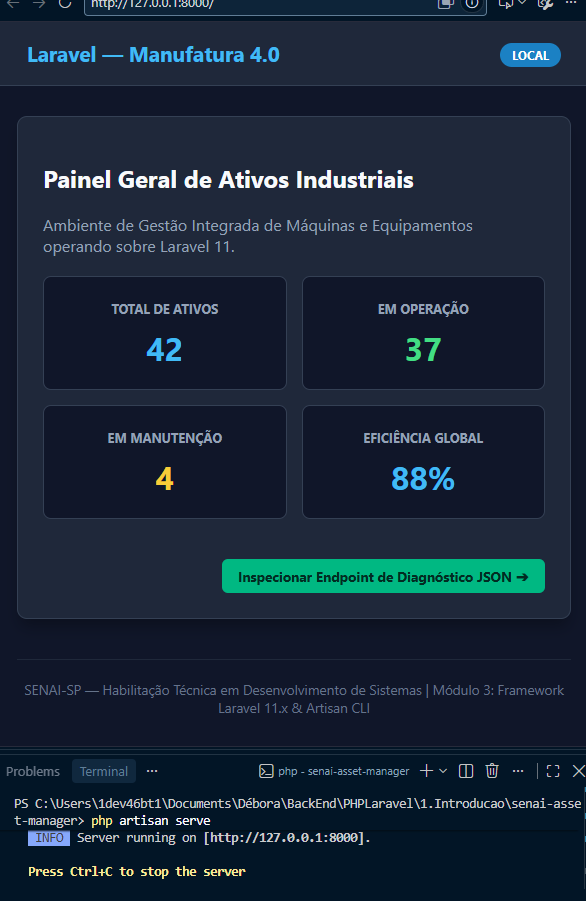

   2. **Teste 2 — Resposta da Rota de Diagnóstico JSON:**  
   Acesse a URL `http://localhost:8000/status` (ou clique no botão verde do painel).  
   *Resultado Esperado:* O navegador exibe a resposta estruturada em JSON semântico:
   ```json
   {
       "plataforma": "SENAI Asset Manager",
       "ambiente": "local",
       "versao_php": "8.3.x",
       "status": "ONLINE",
       "timestamp": "2026-10-30T16:45:00-03:00"
   }
   ```

   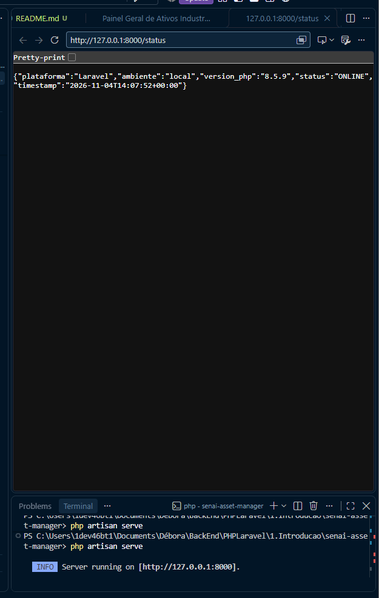

   3. **Teste 3 — Inspeção de Rotas com Artisan:**  
   No terminal, execute `php artisan route:list`.  
   *Resultado Esperado:* As rotas `ativos.index` e `ativos.status` aparecem associadas às ações do `AtivoController`.

   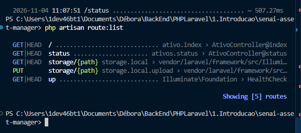


   4. **Teste 4 — Auditoria de Blindagem do Arquivo `.env`:**  
   Abra o terminal e verifique se o `.env` está protegido pelo Git:
   ```bash
   git status --ignored
   ```
   *Resultado Esperado:* O arquivo `.env` aparece listado na seção de arquivos ignorados (`Ignored files`). Ele **nunca** deve aparecer como arquivo rastreado (*Untracked/Staged*)!

   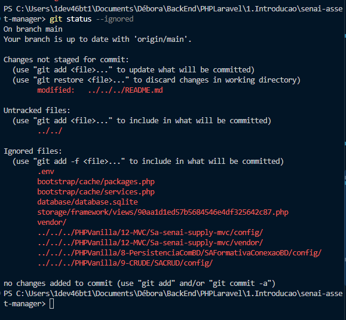

   5. **Teste 5 — Teste de Execução no Terminal Interativo (Tinker):**  
   Abra o REPL do Laravel:
   ```bash
   php artisan tinker
   ```
   Digite os seguintes comandos dentro do Tinker:
   ```php
   config('app.name');
   // Retorna: "SENAI Asset Manager"
   
   now()->format('d/m/Y H:i:s');
   // Retorna a data e hora atual no fuso configurado
   
   exit;
   ```

   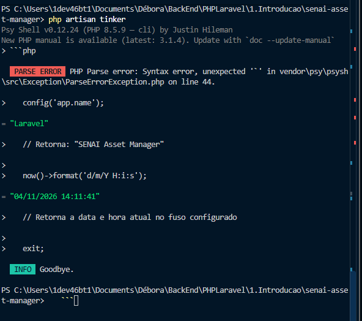

   **Teste 6 — Auditoria da Chave Criptográfica:**  
   Experimente apagar temporariamente o valor da `APP_KEY` no `.env` e recarregue a página no navegador.  
   *Resultado Esperado:* O Laravel bloqueia a execução e exibe a mensagem de segurança alertando sobre a ausência da chave de criptografia.  
   *Restauração:* Execute `php artisan key:generate` para restabelecer a segurança e recarregue a página.

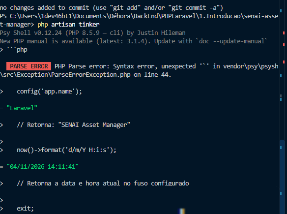


   7. **Teste 7 — Verificação do Painel de Saúde (`php artisan about`):**  
   Execute `php artisan about` no terminal.  
   *Resultado Esperado:* Todos os indicadores técnicos devem estar validados em verde.

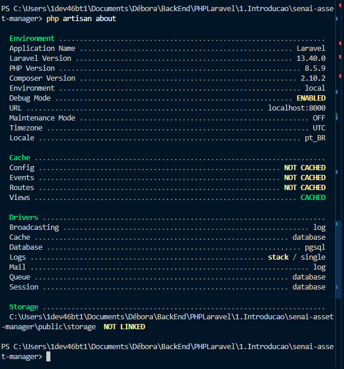


# Continuação da Aplicação - Criação do Módulo Gerenciamento de Clientes

## Criação do Model e Migração do Banco de Dados

Criar o arquivo de migração e o model com o comando

`php artisan make:model Cliente -m`

obs: ao usar a flag `-m` o Laravel cria 2 arquivos o Model e o Migration

- Um arquivo no `database/migration` -> inserir a tabela no banco.
- Um arquivo no `app/Model` -> gerenciador do Modelo de relacional.

comando para Automação do Banco

`php artisan migrate`

## Criar o Controller de Recurso para a Entidade Cliente

Executar o Comando

`php artisan make:controller ClienteController --resouce`

>obs: ao usar flag `--resource` são criados 7 métodos automaticamente dentro do controller

- um arquivo é criado em `app/Http/Controllers/ClienteController.php`

contendo os 7 método de assinatura do resource

## Criar as Rotas Nomeadas para os Controllers Dentro do arquivo
(`routes/web.php`)

Depois de criar o model, executar a migração e implemetar o controller, vamso declarar as rots do módulo em `routes/web.php`

Uso do elemento Resource para gerar Todas as Rotas do Conreoller

`Route::resource()` = > Gera todas as rotas do controller

## Construção das Viewa Blade

Criar o diretório `resource/views/clientes` =>

Criar os arquivos dentro da platas `/clientes`

index.blade.php
create.blade.php
show.blade.php
edit.blade.php


## Execute a sequência de 7 testes no laboratório:

1. **Teste 1 — Listagem Geral e Inspeção das Rotas (`GET /clientes`):**  
   Acesse no navegador `http://localhost:8000/clientes`.  
   *Resultado Esperado:* A tabela renderiza os 3 clientes iniciais de teste com botões de ação RESTful.


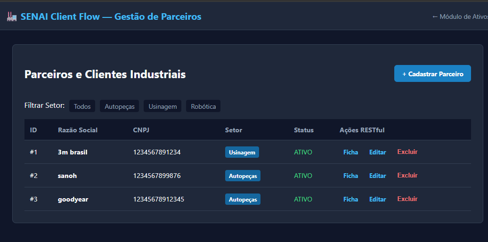

---

2. **Teste 2 — Cadastro via Verbo POST e Proteção Anti-CSRF (`POST /clientes`):**  
   Clique em **+ Cadastrar Parceiro**, informe Razão Social *"Siemens Automação"*, CNPJ *"12.345.678/0001-90"*, setor *"Robótica"* e submeta.  
   *Resultado Esperado:* A requisição POST é validada com `@csrf`, redireciona para a lista exibindo a mensagem verde *"Cliente cadastrado com sucesso!"* e o novo registro #4 no rodapé da tabela.


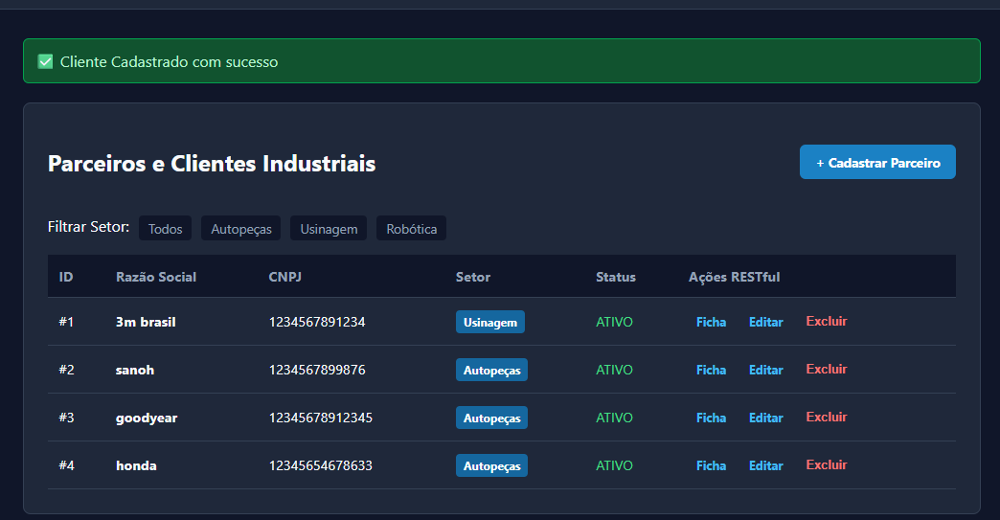


---

3. **Teste 3 — Exibição de Ficha Técnica (`GET /clientes/{id}`):**  
   Clique no botão **Ficha** do cliente #4.  
   *Resultado Esperado:* A rota invoca `show(4)` e renderiza a ficha técnica detalhada.


---

4. **Teste 4 — Teste de Constraint com Falha Intencional (404 Automático):**  
   Tente digitar manualmente na barra de endereços do navegador: `http://localhost:8000/clientes/palavra`.  
   *Resultado Esperado:* Resposta HTTP 404 imediata. O constraint `whereNumber('cliente')` barrou a requisição antes mesmo de invocar o controller!


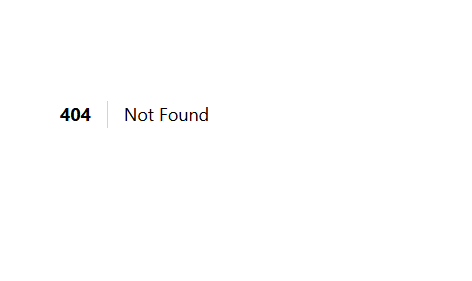


5. **Teste 5 — Atualização com Method Spoofing (`PUT /clientes/{id}`):**  
   Entre em **Editar**, mude a Razão Social para *"Siemens Energy & Automation"* e envie.  
   Abra o DevTools (**F12 ➔ Network/Rede**) ao enviar:  
   *Resultado Esperado:* O formulário envia um POST com payload contendo `_method: PUT` e `_token: ...`. O Laravel despacha para a ação `update()` e salva as alterações.


---


6. **Teste 6 — Exclusão Segura via Verbo DELETE (`DELETE /clientes/{id}`):**  
   Clique no botão vermelho **Excluir** do cliente #4 e confirme a caixa de diálogo.  
   *Resultado Esperado:* A requisição DELETE remove o item da sessão e recarrega a tabela sem o parceiro excluído.


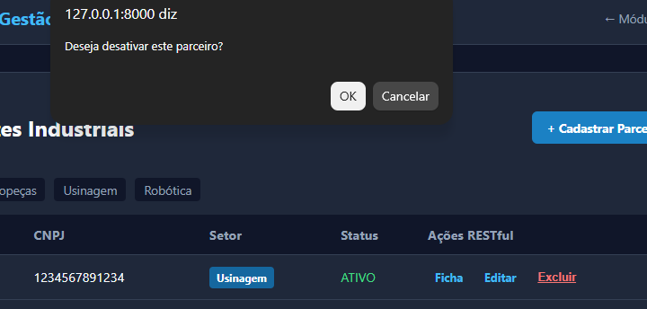

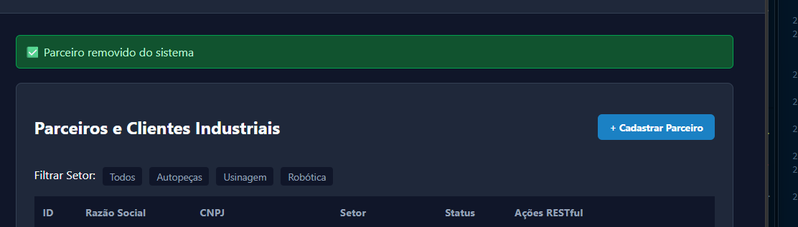

---

7. **Teste 7 — Simulação de Falha de Segurança CSRF (HTTP 419):**  
   No arquivo `resources/views/clientes/create.blade.php`, comente temporariamente a linha `@csrf` e tente cadastrar um novo cliente.  
   *Resultado Esperado:* O Laravel bloqueia a requisição e exibe a tela de erro **419 | PAGE EXPIRED**, comprovando a proteção ativa do middleware `VerifyCsrfToken`!  
   *Restauração:* Descomente a diretiva `@csrf` e recarregue.

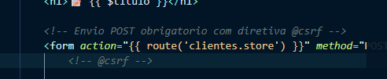

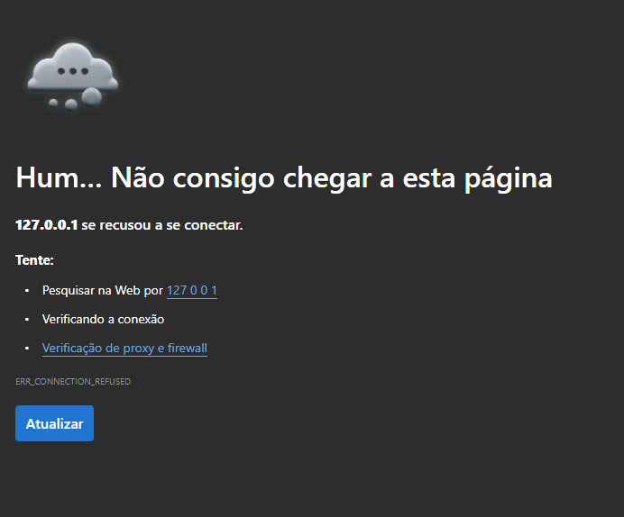


#### LISTA DE EXERCÍCIOS DE FIXAÇÃO E PRÁTICA - Controllers e Routes no LARAVEL

1. **Semântica RESTful: Por que uma ação de exclusão de dados nunca deve ser implementada através de uma requisição HTTP do tipo GET? Explique o risco associado a robôs de busca.**

**Resposta:**
Porque o método GET serve apenas para consultar dados, não para excluir. Robôs de busca podem acessar links automaticamente e acabar excluindo informações sem querer.

---

2. **Idempotência: O que significa o conceito de idempotência no protocolo HTTP e por que o método PUT é considerado idempotente enquanto o POST não é?**

**Resposta:**
Significa que realizar a mesma requisição várias vezes produz o mesmo resultado final. O PUT é idempotente porque atualiza o mesmo recurso, enquanto o POST pode criar vários registros iguais.

---

3. **Resource Controllers: Quais são as 7 ações canônicas geradas pelo comando php artisan make:controller --resource e qual é a responsabilidade de cada uma?**

**Resposta:**
index: lista os registros.

create: exibe o formulário de cadastro.

store: salva um novo registro.

show: exibe os detalhes de um registro.

edit: exibe o formulário de edição.

update: atualiza um registro.

destroy: exclui um registro.

---

4. **Injeção de Dependências: Como o Service Container do Laravel entrega automaticamente uma instância de Request ao método do controller sem que tenhamos que instanciá-la com new Request()?**

**Resposta:**
O Service Container identifica o tipo Request no método e fornece automaticamente uma instância pronta, sem precisar usar new Request().

---

5. **Method Spoofing: Por que os navegadores web não conseguem enviar requisições nativas de PUT e DELETE através de formulários HTML convencionais? Como o Laravel contorna essa limitação?**

**Resposta:**
Os formulários HTML tradicionais aceitam apenas GET e POST. O Laravel resolve isso utilizando o campo oculto _method, que simula métodos como PUT e DELETE.

---

6. **Ataques CSRF: O que é um ataque do tipo Cross-Site Request Forgery e como a diretiva Blade @csrf impede que sites maliciosos forjem requisições em nome do usuário?**

**Resposta:**
É um ataque em que um site malicioso tenta realizar ações usando a sessão de um usuário. A diretiva @csrf gera um token de segurança que o Laravel verifica antes de aceitar a requisição.

---

7. **Constraints de Rota: Para que servem métodos de restrição como whereNumber('id') ou whereAlphaNumeric('codigo') e qual código de status HTTP o Laravel retorna quando o formato é violado?**

**Resposta:**
Servem para limitar os valores aceitos nas URLs, garantindo que IDs sejam numéricos ou códigos tenham o formato esperado. Quando não atendem à restrição, o Laravel retorna erro 404.

---

8. **Rotas Nomeadas: Cite duas vantagens corporativas de utilizar a função auxiliar route('clientes.show', $id) nas views em vez de escrever strings estáticas como "/clientes/{$id}".**

**Resposta:**
Facilitam a manutenção do código e permitem alterar URLs sem precisar modificar todos os links das views. Também evitam erros ao montar endereços manualmente.

---

9. **Single Responsibility no Controller: Por que a validação de formulários com $request->validate() ou Form Requests deve ser mantida enxuta dentro do controller para respeitar o limite de 20 linhas por função?**

**Resposta:**
Porque o controller deve cuidar apenas do fluxo da requisição. Validações muito grandes dificultam a manutenção; por isso, podem ser separadas em Form Requests.

---

10. **A Ferramenta route:list: Como o comando php artisan route:list auxilia equipes multidisciplinares a documentar e auditar os endpoints disponíveis em uma API ou aplicação web?**

**Resposta:**
Mostra todas as rotas cadastradas, seus métodos HTTP, endereços, nomes e controllers responsáveis. Ajuda a equipe a documentar, conferir e identificar possíveis conflitos nas rotas.